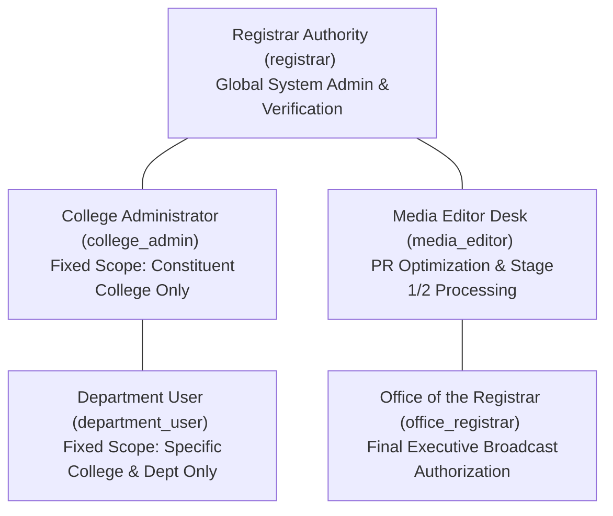
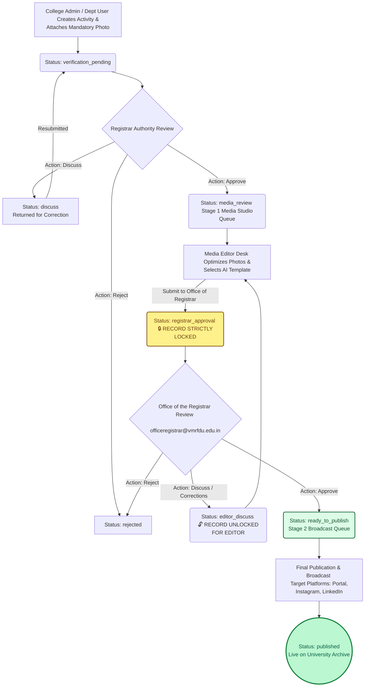
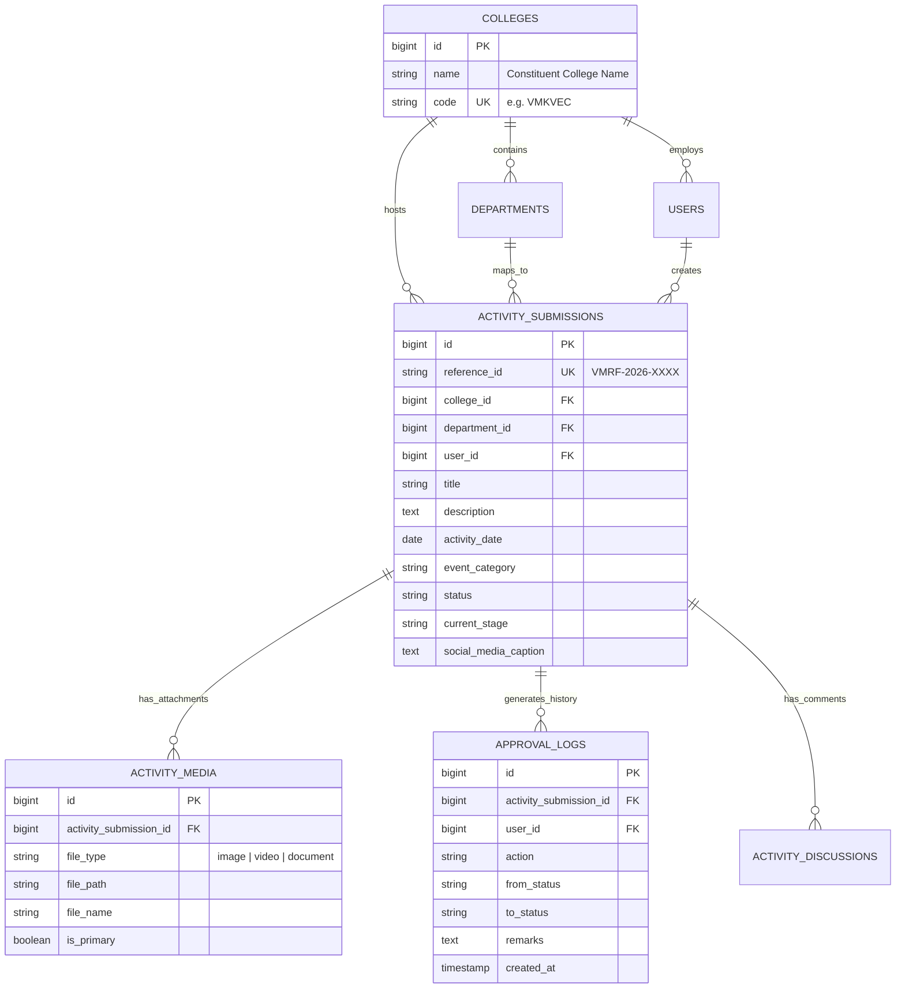

# VINAYAKA MISSION'S RESEARCH FOUNDATION (DEEMED TO BE UNIVERSITY)
## Comprehensive Technical & Functional Project Report
### Institutional Activity Management, Verification, Media Studio & Public Broadcast Portal

---

| Project Parameter | Details |
| :--- | :--- |
| **Project Title** | Centralized Institutional Activity & Media Broadcast Portal |
| **Organization** | Vinayaka Mission's Research Foundation (Deemed to be University) — VMRF(DU) |
| **Target Users** | University Registrar, Office of the Registrar, Media Editor Studio, College Administrators, Department Heads |
| **Technology Stack** | Laravel 11 (PHP 8.2+), MySQL 8.0, Bootstrap 5.3, Vanilla CSS Design Tokens, AI Phrasing Engine |
| **Architectural Pattern** | Model-View-Controller (MVC) with Multi-Tiered Role-Based Access Control (RBAC) & State Locking |
| **Footer Standard** | `2026 VMRF(DU) – Vinayaka Mission's Research Foundation (Deemed to be University). All Rights Reserved. Under the Guidance of: Dr. A. Murugan. Designed & Developed by Dhinakaran & Sanjai, Web Development Team.` |

---

## CHAPTER 1: EXECUTIVE SUMMARY & OBJECTIVES

### 1.1 Problem Statement
In a multi-disciplinary deemed university comprising numerous constituent colleges, schools, and specialized research centers, tracking institutional activities (symposiums, guest lectures, medical screening camps, MoUs, hackathons) previously suffered from data fragmentation, delayed administrative visibility, inconsistent social media PR branding, and lack of verified audit trails.

### 1.2 Core Project Objectives
The VMRF(DU) Institutional Activity Portal was developed to solve these challenges by delivering:
1. **Single Source of Truth**: A unified repository capturing structured activity records across every constituent college and department.
2. **Mandatory Visual Documentation**: Enforcing high-resolution image attachments for every event to maintain historical and institutional records.
3. **Multi-Stage Verification Pipeline**: Establishing a strict gatekeeper workflow between local college submission, Registrar verification, Media Studio enhancement, and Executive Registrar authorization.
4. **Automated AI & PR Standardization**: Providing universal AI phrasing tools and >10 professional institutional templates to elevate the quality of public broadcast captions across social channels (Instagram, LinkedIn, Twitter/X).
5. **Absolute Scope Isolation**: Guaranteeing that college administrators and departmental users can only access data belonging to their assigned institutional unit.

---

## CHAPTER 2: ROLE-BASED ACCESS CONTROL (RBAC) & DATA SCOPING

The platform enforces five distinct administrative and user tiers. Every request is filtered through custom middleware and controller-level security checks (`abort_if(!canAccess(), 403)`).

### Detailed Role Responsibility Matrix

| Role Name | System Identifier | Institutional Scope & Data Access | Core Permissions & Functional Capabilities |
| :--- | :--- | :--- | :--- |
| **Registrar Authority** | `registrar` | **Global (University-Wide)** across all constituent colleges and departments. | • Creates & manages colleges, departments, and user accounts. • Performs Stage 1 Institutional Verification (`Approve to Media Studio`, `Discuss`, `Reject`). • Views global analytics, executive KPIs, and audit trails. |
| **Office of the Registrar** | `office_registrar` (`officeregistrar@vmrfdu.edu.in`) | **Global Executive Oversight** focused strictly on Stage 2 / Stage 3 media packages. | • Conducts final executive evaluation of edited media packages. • Authorizes broadcast (`ready_to_publish`) or unlocks package with correction notes (`editor_discuss`). • Strictly prohibited from altering initial Stage 1 local college verifications. |
| **Media Editor Desk** | `media_editor` | **Global Media Studio Queue** across all approved activities. | • Enhances event photographs and refines social media captions. • Uses Universal AI Phrasing & Template Library. • Downloads complete media packs (`.ZIP`). • **Locked Out** from modifying any submission currently undergoing review by the Office of the Registrar. |
| **College Administrator** | `college_admin` | **Strictly College-Scoped**. Restricted exclusively to their assigned constituent college. | • Creates institutional activity submissions (Constituent College field is permanently locked to their assigned college). • Tracks review statuses and responds to administrative queries. • Views college-specific dashboard charts and metrics. |
| **Department User** | `department_user` | **Strictly Department-Scoped**. Restricted to their assigned academic department. | • Submits activities mapped to their department. • Views status tracking and verification feedback. |

---

## CHAPTER 3: DETAILED MODULE SPECIFICATIONS

### 3.1 Institutional Activity Submission Engine (`ActivitySubmissionController`)
* **Mandatory Image Enforcement**: To prevent incomplete records, the system enforces backend validation (`'images' => 'required|array|min:1'`) and frontend HTML5 requirements. Submissions without at least one photo (`JPG, PNG, WEBP` up to 10MB) are rejected.
* **Supplementary Attachments**: Supports optional PDF brochures (`document` up to 15MB) and video clip links (YouTube/Google Drive).
* **Automated Reference ID**: Upon creation, each submission generates a unique reference ID (e.g., `VMRF-2026-0842`) for tracking through the workflow.

### 3.2 Universal AI Phrasing & >10 Institutional Template Library
To ensure academic elegance and PR consistency, an interactive template engine is embedded across all user workflows (`submissions/create`, `submissions/edit`, and `media/dashboard`):
* **12+ Professional Institutional Templates**: Categorized under intuitive tabs:
  1. *Academic Symposium & National Conference*
  2. *International Hands-on Workshop*
  3. *Community Health & Medical Screening Outreach Camp*
  4. *Research Colloquium & Expert Guest Lecture*
  5. *Strategic Industry Partnership & MoU Signing*
  6. *Value Added & Skill Development Program*
  7. *Annual Inter-College Sports Championship*
  8. *Institutional Cultural & Arts Extravaganza*
  9. *Faculty Development Program (FDP)*
  10. *Alumni Meet & Career Mentorship Conclave*
  11. *24-Hour Innovation & Hackathon Challenge*
  12. *NSS / NCC Environmental & Community Outreach Drive*
* **Dynamic Context Injection**: Selecting a template dynamically weaves the active form's Event Title and Constituent College Name into the generated text.
* **Live AI Caption Generator**: Synthesizes platform-optimized captions with official hashtags (`#VMRFDU #DeemedUniversity #Excellence`).

### 3.3 Stage 1 Institutional Verification (`ApprovalController`)
* **Review Queue**: Activities submitted by colleges land in `verification_pending`.
* **Administrative Actions**:
  * `Approve`: Promotes record to `media_review` (Media Studio Desk).
  * `Discuss`: Returns record to college admin with mandatory feedback notes for correction.
  * `Reject`: Archives record with formal rejection rationale.

### 3.4 Media Studio Desk & Status Locking Architecture (`MediaEditorController`)
* **Stage 1 Media Processing Queue**: Lists all records approved by the Registrar awaiting photo cropping and caption optimization.
* **Status Locking Engine**: When the Media Editor clicks **"Submit for Registrar Approval"**, the submission transitions to `registrar_approval`.
  * **Security Lock**: The controller blocks any `POST`, `PUT`, or `PATCH` modification requests while in this state.
  * **Visual Padlock Queue**: The record moves to a dedicated **Locked Submissions Pending Office of the Registrar Review** dashboard section displaying `🔒 LOCKED: Pending Registrar Review`.
* **One-Click Media Pack Export**: Editors can click **Download Pack** to dynamically generate and download a ZIP archive (`/media-editor/{id}/download-pack`) containing all raw photos, optimized images, and PDF event brochures.

### 3.5 Stage 2 Executive Review & Unlocking Engine
* **Executive Evaluation**: The Office of the Registrar (`officeregistrar@vmrfdu.edu.in`) reviews the locked package.
* **Unlocking via "Discuss"**: If corrections are required, the Registrar marks the submission as `Discuss`. The system transitions the status to `editor_discuss`, automatically **unlocking** the record and returning it to the Media Editor's processing queue.
* **Final Authorization**: Marking `Approve` promotes the package to `ready_to_publish`.

### 3.6 Stage 3 Final Broadcast Publication
* Authorized packages enter the publication queue where authorized personnel select target channels (*Portal Archive, Instagram Official, LinkedIn Official, Twitter/X*) and trigger immediate live dispatch or scheduled posting.

---

## CHAPTER 4: END-TO-END WORKFLOW & STATE TRANSITION FLOWCHARTS

### 4.1 Comprehensive Lifecycle Architecture

---

### 4.2 State Machine Transition Table

| Current Status | Triggering Action | Performing Role | Next Status | Lock State |
| :--- | :--- | :--- | :--- | :--- |
| `New / Draft` | Submit Record | `college_admin` / `department_user` | `verification_pending` | Unlocked for Registrar |
| `verification_pending` | Click "Approve" | `registrar` | `media_review` | Editable by Media Editor |
| `verification_pending` | Click "Discuss" | `registrar` | `discuss` | Returned to College Admin |
| `media_review` | Click "Submit to Registrar" | `media_editor` | `registrar_approval` | **🔒 LOCKED** (Read-Only) |
| `registrar_approval` | Click "Discuss" | `office_registrar` | `editor_discuss` | **🔓 UNLOCKED** for Media Editor |
| `registrar_approval` | Click "Approve" | `office_registrar` | `ready_to_publish` | Queued for Broadcast |
| `ready_to_publish` | Click "Publish Live Now" | `media_editor` / `registrar` | `published` | Permanently Archived |

---

## CHAPTER 5: DATABASE SCHEMA & ENTITY RELATIONSHIPS

The application relies on a normalized relational MySQL schema with strict foreign key constraints and audit logging.

---

## CHAPTER 6: QUALITY ASSURANCE & SECURITY COMPLIANCE

During system verification, robust safeguards were implemented and tested:
1. **CSRF Protection (`@csrf`)**: Verified across all Blade form submissions (`create`, `edit`, `media-editor/modals`) to prevent Cross-Site Request Forgery (eliminating HTTP 419 Page Expired errors).
2. **Controller Authorization Defenses**: Direct URL manipulation attacks (e.g., a College Admin attempting to edit an activity belonging to another college or modifying a locked record) trigger immediate `abort(403, 'Unauthorized action.')`.
3. **MIME-Type & File Size Validation**: Server-side validation restricts uploads strictly to `jpeg, png, jpg, webp` images (max 10MB) and `pdf` documents (max 15MB).
4. **View Compilation Integrity**: All templates compiled and verified using `php artisan view:cache` with zero syntax or compilation defects.

---

## CHAPTER 7: SUMMARY & CONCLUSION

The **VMRF(DU) Institutional Activity Portal** stands as a fully realized, secure, and aesthetically state-of-the-art institutional platform. By seamlessly merging local college accountability with automated AI PR tools, strict status locking, and executive review safeguards, the portal guarantees that every institutional achievement celebrated by Vinayaka Mission's Research Foundation (Deemed to be University) is archived with historical accuracy and broadcast with professional excellence.

---
*Report Compiled & Verified: July 2026*  
**2026 VMRF(DU) – Vinayaka Mission's Research Foundation (Deemed to be University). All Rights Reserved.**  
**Under the Guidance of: Dr. A. Murugan**  
**Designed & Developed by: Dhinakaran & Sanjai, Web Development Team**
