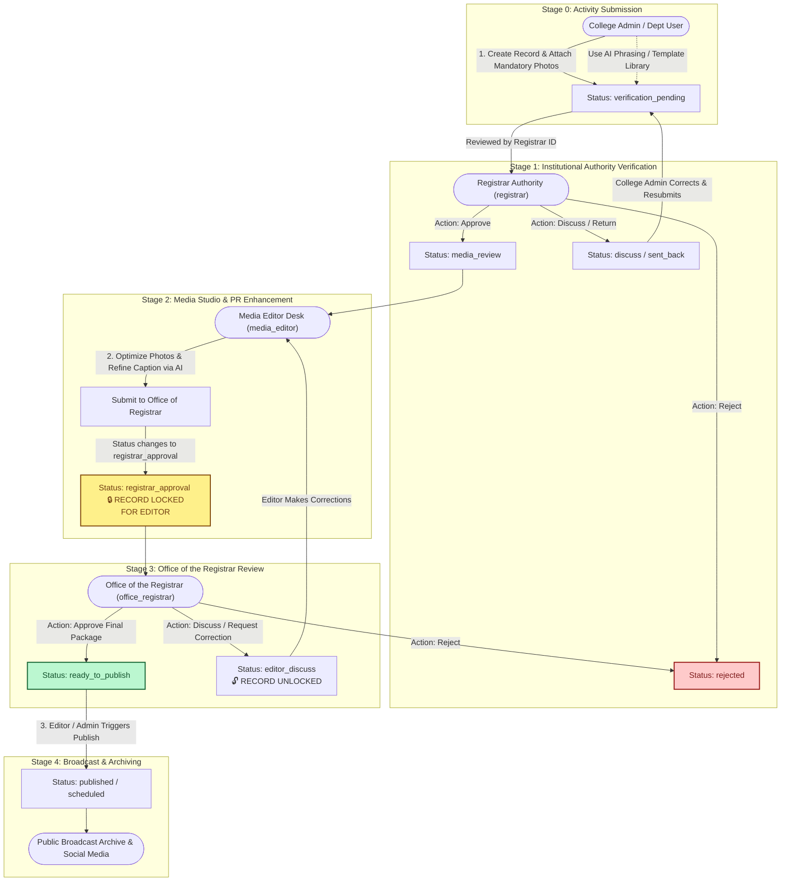
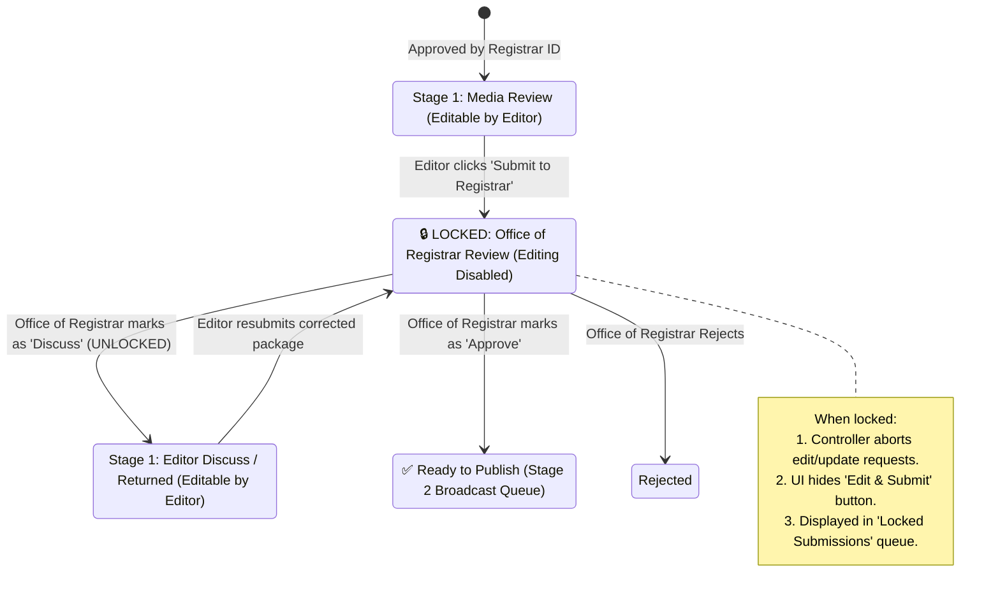
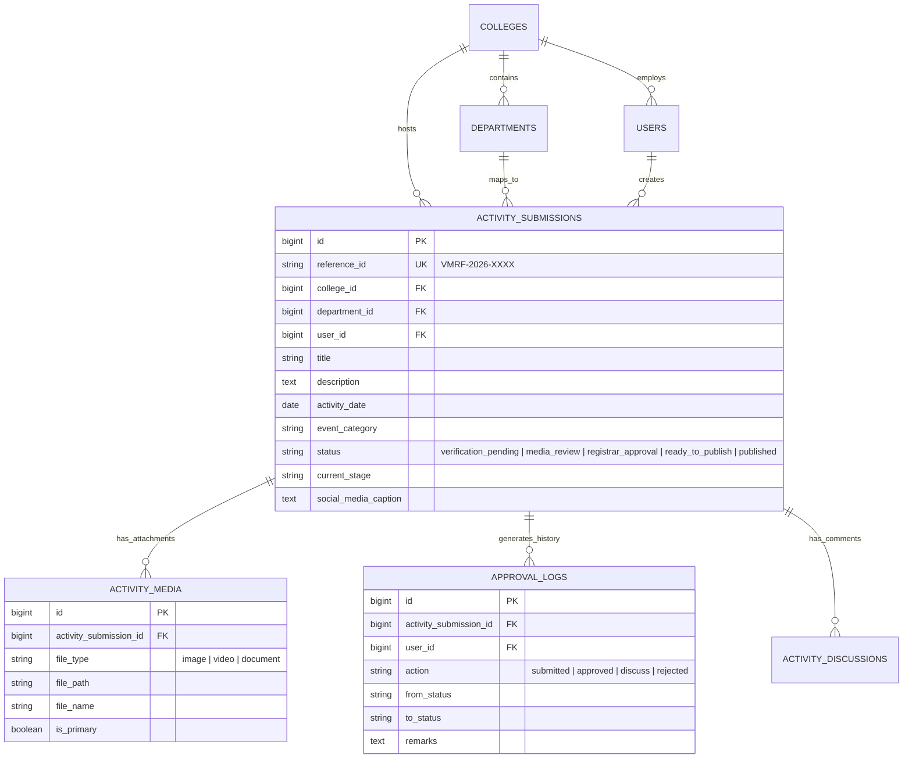

# VMRF(DU) Institutional Activity Portal
## Technical Architecture, Workflow Flowcharts & System Documentation

> **Vinayaka Mission's Research Foundation (Deemed to be University)**  
> *Centralized Institutional Activity Management, Verification, Media Studio Enhancement, and Public Broadcast System.*

---

## 1. Executive Summary

The **VMRF(DU) Institutional Activity Portal** is an enterprise-grade web application designed to digitize, standardize, verify, and broadcast academic, research, medical outreach, and cultural events across all constituent colleges and departments of Vinayaka Mission's Research Foundation (Deemed to be University).

The platform introduces a **strict, multi-tiered institutional review lifecycle** that ensures every event record undergoes administrative verification by the Registrar, visual and PR enhancement by the Media Editor Desk, and final executive authorization by the Office of the Registrar before being published to the university portal archive or broadcast to official social media channels (Instagram, LinkedIn, Twitter/X).

---

## 2. Interface Showcase & UI Screenshots

### 2.1 Media Studio Desk & Status Locking Queue
The Media Editor Studio Desk (`/media-editor`) organizes verified institutional packages into structured processing queues. Once a package is submitted to the Office of the Registrar (`officeregistrar@vmrfdu.edu.in`), it automatically transitions to a **Locked Queue** with explicit padlock indicators preventing unauthorized edits.


---

### 2.2 Universal AI Phrasing & Institutional Template Library (>10 Templates)
Available to all users across activity creation, modification, and media editing forms, the interactive modal provides instant access to **12+ pre-drafted institutional broadcast templates** alongside real-time AI social media caption synthesis.


---

### 2.3 Activity Submission Form & Mandatory Gallery Enforcement
The submission form guarantees data integrity by strictly enforcing the upload of at least one high-resolution gallery image (`images[]`) along with optional PDF event brochures and video links.


---

## 3. Role-Based Access Control (RBAC) & Scope Matrix

The portal strictly enforces strict data isolation and role-based permissions across five specialized institutional roles:

| Role Name | Identifier / System Role | Primary Responsibilities & Scope | Access Permissions & Limitations |
| :--- | :--- | :--- | :--- |
| **Registrar Authority** | `registrar` | Initial institutional verification of submitted records, global system analytics, college & department setup, user administration. | Full administrative access. Performs Stage 1 institutional verification (`Approve to Media Studio`, `Discuss`, `Reject`). |
| **Office of the Registrar** | `office_registrar` (`officeregistrar@vmrfdu.edu.in`) | Final executive review and authorization of media packages prepared by the Media Editor Desk. | Evaluates optimized photos and refined PR captions. Approves for broadcast (`ready_to_publish`) or returns for correction (`editor_discuss`). Cannot perform initial Stage 1 verification. |
| **Media Editor Desk** | `media_editor` | Visual optimization, photo enhancement, AI broadcast caption refinement, downloading ZIP media packs. | Accesses Stage 1 editing queue (`media_review`, `editor_discuss`) and Stage 2 broadcast queue (`ready_to_publish`). Cannot edit records locked under Registrar review. |
| **College Administrator** | `college_admin` | Submits, manages, and tracks activities for their assigned constituent college. | **Strictly college-scoped**. Can only view, create, and edit records belonging to their assigned college. College field is locked upon creation. |
| **Department User** | `department_user` | Submits and tracks activities for a specific academic department within a constituent college. | **Strictly college & department-scoped**. Can only interact with records mapped to their specific department. |

---

## 4. End-to-End System Workflow Flowchart

The diagram below illustrates the complete life cycle of an institutional activity submission—from creation by college administrators to final publication on public channels.



---

## 5. Submission Locking & Unlocking State Machine

To preserve review integrity, the system implements an automatic locking mechanism when activities are transferred between the Media Editor and the Office of the Registrar.



---

## 6. Core System Modules & Features

### 6.1 Mandatory Image Verification & Attachment Engine
- **Strict Enforcement**: Every activity submission must include at least one high-resolution image (`images[]`). The backend `ActivitySubmissionController` enforces validation (`required|array|min:1`).
- **Media Gallery Storage**: Uploaded files are hashed, stored in `/uploads/activities/images/`, and indexed in the `activity_media` table with automatic primary image tagging (`is_primary = true`).
- **Supplemental Brochures**: Supports optional PDF event brochures (`document`) up to 15MB.

### 6.2 Universal AI Phrasing & Institutional Template Library (>10 Templates)
Available to **all portal users** across activity creation, modification, and media editing modal windows:
- **12+ Professional Institutional Templates**: Pre-configured, high-standard broadcast phrasing organized into specialized categories:
  1. *Academic Symposium & National Conference*
  2. *International Hands-on Technical Workshop*
  3. *Community Health & Medical Screening Outreach Camp*
  4. *Research Colloquium & Expert Guest Lecture*
  5. *Strategic Industry Partnership & MoU Signing*
  6. *Value Added & Professional Skill Development Program*
  7. *Annual Inter-College Sports Championship*
  8. *Institutional Cultural & Arts Extravaganza*
  9. *Faculty Development Program (FDP)*
  10. *Alumni Meet & Career Mentorship Conclave*
  11. *24-Hour Innovation & Hackathon Challenge*
  12. *NSS / NCC Environmental & Community Outreach Drive*
- **Dynamic Placeholder Replacement**: Clicking **"Use This Template"** automatically detects the active form's Event Title and College Name, injecting customized institutional phrasing directly into the description or caption field.
- **Live AI Phrasing Generator**: Connects to `/api/ai/generate-captions` to synthesize platform-specific suggestions (Instagram, LinkedIn, Twitter/X) with emojis and official university hashtags (`#VMRFDU`).

### 6.3 Media Editor Studio Desk (`/media-editor`)
- **Stage 1 (Photo & Caption Editing)**: Displays verified queues awaiting editorial enhancement alongside a visual count badge.
- **Locked Submissions Monitor**: Dedicated section showing all records currently awaiting evaluation by `officeregistrar@vmrfdu.edu.in`.
- **Stage 2 (Ready for Broadcast)**: Manages final authorized packages ready for immediate publication or scheduled dispatch.
- **One-Click ZIP Export**: Packages all high-resolution photos, primary edited images, and PDF documents into a downloadable ZIP archive (`/media-editor/{id}/download-pack`).

---

## 7. Database Schema Overview



---

## 8. Key HTTP Routes & Controller Mapping

| HTTP Method | Route URI | Controller & Action | Middleware / Security Scope |
| :--- | :--- | :--- | :--- |
| `GET` | `/dashboard` | `DashboardController@index` | `auth` & Role-scoped metric computation |
| `GET` | `/submissions` | `ActivitySubmissionController@index` | Scoped by `college_id` for college admins |
| `POST` | `/submissions` | `ActivitySubmissionController@store` | Enforces mandatory `images[]` upload |
| `POST` | `/submissions/{id}/approval` | `ApprovalController@processAction` | Authority verification (`registrar` / `office_registrar`) |
| `GET` | `/media-editor` | `MediaEditorController@dashboard` | Restricted to `media_editor` & authorities |
| `POST` | `/media-editor/{id}/submit-registrar` | `MediaEditorController@submitToRegistrar` | Locks submission (`status = registrar_approval`) |
| `POST` | `/media-editor/{id}/publish` | `MediaEditorController@publish` | Transitions to `published` & creates broadcast feed |
| `GET` | `/media-editor/{id}/download-pack` | `MediaEditorController@downloadMediaPack` | Generates on-the-fly ZIP bundle |
| `POST` | `/api/ai/generate-captions` | `ActivitySubmissionController@generateAiCaptions`| Returns instant AI phrasing & social captions |

---

## 9. Footer & Branding Standard
All public and portal pages adhere strictly to the university branding standard:
```html
2026 VMRF(DU) – Vinayaka Mission's Research Foundation (Deemed to be University). All Rights Reserved.
Designed & Developed by VMRF(DU) Web Team
```
